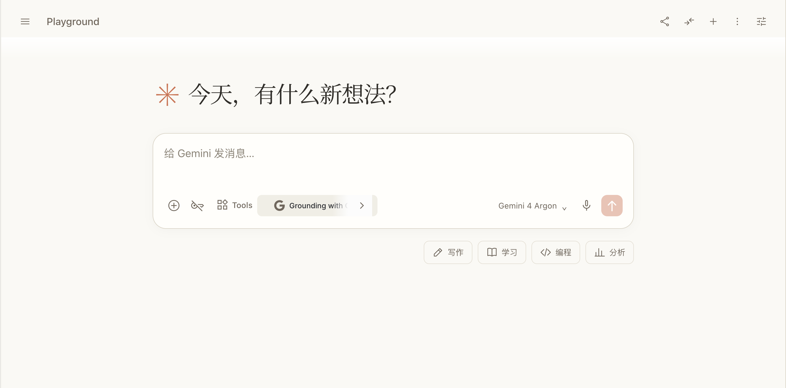

# AI Studio · Claude 双主题与默认设置

给 Google AI Studio 换上 Claude 风格的暖纸或暗黑界面，按需搭配 Gemini 4 Argon、High 思考和无闪烁侧栏启动。

## 安装：两个脚本，按需选择

先在 Chrome 安装 [Tampermonkey](https://www.tampermonkey.net/)，再点击所需脚本并在油猴安装页确认。两者可以一起启用，也可以只安装其中一个。

| 脚本 | 版本 | 安装 |
|---|---|---|
| 默认 Gemini 4 Argon、High 思考、启动折叠右侧栏 | 3.1.0 | [安装默认设置脚本](https://raw.githubusercontent.com/fisherbio/aistudio-claude-userscripts/main/aistudio-argon-defaults.user.js) |
| Claude 暖纸与暗黑双主题 | 2.0.4 | [安装主题脚本](https://raw.githubusercontent.com/fisherbio/aistudio-claude-userscripts/main/aistudio-claude-theme.user.js) |

安装后刷新 [AI Studio Playground](https://aistudio.google.com/prompts/new_chat)。若链接只显示源码，可在油猴中新建脚本、粘贴完整源码并保存。Chrome 中若油猴提示脚本执行权限，请按扩展自己的引导开启。

**从主题 1.3.0 或 PR 试用版升级**：2.0.0 改了脚本名称。安装后到油猴管理面板确认只启用一份主题脚本；如果新版被装成另一份，先停用旧版或试用版。默认设置脚本可以继续启用。

默认设置脚本也只需启用一份；停用其他自动关闭 Run settings 的脚本，以免争抢面板。

## 默认设置脚本：后台配置，再显示完成的页面

- 在 `document-start` 安装启动遮罩，隐藏 Run settings 与模型选择弹层，避免可见的展开、切换和折叠动画。
- 通过 AI Studio 原生控件选择 **Gemini 4 Argon** 和 **High**，读回确认后折叠侧栏、解除遮罩。
- 支持 `/prompts/` 下的刷新、新建对话和 SPA 导航。
- 配置失败时解除遮罩并显示提示，保留面板供检查；油猴菜单可重试、查看状态或切换侧栏。

每次打开或新建对话时会重新应用默认设置，包括打开已有对话。初始化完成后仍可手动换模型；下一次刷新或新建对话会恢复 Argon / High。要长期使用别的默认模型，可停用此脚本。

**账户必须能使用该模型和 High 选项。** 脚本只操作现有界面，不提供模型权限，也不会自动发送请求。

## 双主题：左键切外观，右键开设置

未设置偏好时，默认以**暗黑主题**启动，对话区最大宽度为 **960px**。想保留 1.3.0 的观感？右键点 AI Studio 右上角的太阳／月亮按钮，在「启动默认外观」选「默认暖纸」，在宽度选项里选「760px 紧凑」。

- **切换当前外观**：左键点击太阳／月亮按钮，在暖纸和暗黑之间切换。浏览器支持 View Transition 且未启用减少动态效果时，会播放圆形扩散动画。临时切换不改变下次启动的默认外观。
- **打开 Claude 偏好设置**：右键或 Alt+左键点击该按钮，也可用 Alt+C 或油猴菜单「Claude 偏好设置」。图钉可让面板在点击外部时保持打开；按 Esc 或点击「完成」可关闭。
- **调整阅读体验**：动画速度可调至 **0.1×–2.0×**，对话宽度可选 **760px、960px、1120px、100%**。动画速度、宽度和启动外观会保存在本机；「恢复默认」会还原为 **1.0×、960px、暗黑**。
- **查看思考内容**：点击回答上方的「Thoughts」展开或收起。思考区沿用 AI Studio 的原生内容和控件，暖纸和暗黑主题下都采用轻量折叠样式。
- **回到原版**：在油猴管理面板停用主题脚本并刷新。主题切换也会尝试同步 AI Studio 自己的主题偏好；如果刷新后原生外观仍是暗色，可在 AI Studio 的外观设置里改回。

两种外观都保留居中阅读栏、衬线回答、对话胶囊输入框和原生模型选择器。发出的消息靠右显示为紧凑气泡，作者和时间不占一行。输入框获得焦点时，外侧圆角边框会高亮；用 Tab 移到按钮时，焦点提示跟随按钮。主题隐藏回复底部的点赞／点踩按钮及其占位，保留运行信息和状态提示。「写作 / 学习 / 编程 / 分析」只在草稿为空时填入提示，不会自动发送。主题不改变回答原文，也不替换 Markdown 或 KaTeX 解析器。

## 公式与排版：1.3.0 及以前的实测记录



2026-11-01，在 Chrome / Tampermonkey 5.5.1 中使用 Gemini 3.8 Flash 完成两次真实对话测试：

| 内容 | 结果 |
|---|---|
| 中文、粗体、斜体、列表、引用、Markdown 表格 | 正常 |
| Python / TeX 代码围栏 | 保留源码，不误渲染成公式 |
| `$…$`、`\(…\)` 行内公式 | 正常；已修复主题造成的空白和拆行 |
| `$$…$$` 独立公式、积分、上下标、矩阵 | 正常 |
| `$$` 内的 `aligned` 多行环境 | 正常对齐 |
| `\[…\]` 包裹的 `aligned` | 本次 AI Studio 原生未识别，显示源码；同一公式改用 `$$…$$` 后正常 |

推荐独立公式使用 `$$…$$`，例如：

```latex
$$
\begin{aligned}
S(t)&=e^{-\lambda t}\\
H(t)&=\int_0^t h(u)\,du
\end{aligned}
$$
```

这里验证的是 AI Studio 的原生数学渲染，不是完整 `.tex` 文档或宏包的 LaTeX 编译。

### 1.3.0：按 Claude 实页校准比例

2026-11-02，参考 Claude 实际页面，并基于上述真实对话在 Chrome **110% 和 125%** 缩放下回归：

- 对话输入框从约 144px 缩至 54px，包含下方工具行的底部区域从约 162px 缩至 102px；以上均为 CSS 像素，不乘浏览器缩放比例。
- 回答正文从原先 17px / 30.6px 的设定统一为实测 16px / 24px，修正原生嵌套节点导致的字号混用；表格实测为 14px / 21px。
- 五行草稿可自动增高，清空后缩回；附件菜单、工具菜单和原生模型选择器可正常打开。
- 检查行内公式、独立公式、矩阵、Markdown 表格与代码围栏；首页与对话间切换、临时恢复原版布局均正常。

## 权限、兼容性与反馈

两份脚本均只匹配 `https://aistudio.google.com/*`，使用 `GM_registerMenuCommand` 添加油猴菜单。主题脚本还使用 `GM_getValue` / `GM_setValue` 在油猴中读写外观偏好。脚本不包含 API 密钥、遥测或向第三方上传对话的逻辑；模型请求仍由 AI Studio 本身处理。

2.0.0 的设置面板在某些严格限制 HTML 写入的页面环境中可能无法打开。脚本也依赖 AI Studio 的页面结构和控件标签。遇到问题，请在 [Issues](https://github.com/fisherbio/aistudio-claude-userscripts/issues) 提供脚本版本、复现步骤和已去除隐私信息的截图。不要上传 API 密钥或私人对话。

## 开发

无需构建或依赖安装。要自定义配色，可调整主题脚本的 `--cs-*` CSS 变量。修改 `.user.js` 后在油猴中保存并刷新 AI Studio。Node.js 可做基础语法检查：

```sh
node --check aistudio-argon-defaults.user.js
node --check aistudio-claude-theme.user.js
```

语法检查不代替真实页面的交互与视觉验证。

## 社区认可

认可并支持 [LINUX DO — 新的理想型社区](https://linux.do/)，感谢社区提供技术交流、经验分享与互助的平台。

## 许可与致谢

[MIT](LICENSE)。默认设置脚本保留原有 `Antigravity` 作者标注。主题的暖纸配色参考了用户提供的个人 TeX 样式，仓库不分发该参考文件。

这是第三方用户脚本项目，与 Google 或 Anthropic 无隶属关系；产品名称与商标归各自权利人所有。
