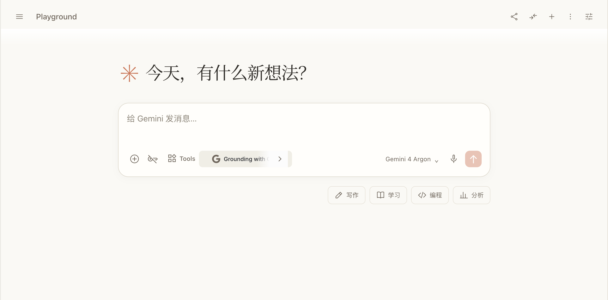

# AI Studio · Claude 双主题与默认设置

给 Google AI Studio 换上 Claude 风格的暖纸或暗黑界面，按需搭配 Gemini 4 默认模型与思考强度自动切换、无闪烁侧栏启动，以及 KaTeX 公式 LaTeX / Markdown 还原复制。

## 安装：三个脚本，按需选择

先在 Chrome 安装 [Tampermonkey](https://www.tampermonkey.net/)，再点击所需脚本并在油猴安装页确认。三者完全独立，可以一起启用，也可以只安装其中任意一个。

| 脚本 | 版本 | 安装 |
|---|---|---|
| Gemini 4 默认模型与思考强度自动切换、启动折叠右侧栏 | 4.0.1 | [安装默认设置脚本](https://raw.githubusercontent.com/fisherbio/aistudio-claude-userscripts/main/aistudio-argon-defaults.user.js) |
| Claude 暖纸与暗黑双主题 | 2.0.7 | [安装主题脚本](https://raw.githubusercontent.com/fisherbio/aistudio-claude-userscripts/main/aistudio-claude-theme.user.js) |
| 公式复制还原 LaTeX / Markdown（独立轻量脚本） | 1.0.0 | [安装公式复制脚本](https://raw.githubusercontent.com/fisherbio/aistudio-claude-userscripts/main/aistudio-katex-copy.user.js) |

安装后刷新 [AI Studio Playground](https://aistudio.google.com/prompts/new_chat)。若链接只显示源码，可在油猴中新建脚本、粘贴完整源码并保存。Chrome 中若油猴提示脚本执行权限，请按扩展自己的引导开启。

**从旧版升级**：主题脚本 2.0.0、默认设置脚本 4.0.1 均更新了脚本名称。安装后到油猴管理面板确认每类脚本只启用一份；如果新版被装成另一份，先停用旧版或试用版。

停用其他自动关闭 Run settings 的脚本，以免争抢面板。

## 默认设置脚本：自定义 Gemini 4 预设，后台无闪烁切换

- **支持全部 Gemini 4 系列模型及各自可用思考强度**：
  - **Gemini 4 Neon** (`gemini-4-neon`)：`Low` / `Medium` / `High` / `Extra High`
  - **Gemini 4 Hydrogen** (`gemini-4-hydrogen`)：`Low` / `Medium` / `High` / `Extra High`
  - **Gemini 4 Carbon** (`gemini-4-carbon`，Paid)：`Low` / `Medium` / `High`
  - **Gemini 4 Argon** (`gemini-4-argon`)：`Low` / `Medium` / `High`
  - 首次安装默认沿用 **Gemini 4 Argon · High**，各模型独立记住各自选过的思考强度，并通过油猴存储跨标签页实时同步。
- **顶栏胶囊与油猴菜单双入口**：顶部工具栏右侧提供轻量胶囊按钮（如 `Argon · High ▾`，自动适配暖纸/暗黑主题与 AI Studio 原生主题），点击可弹出面板切换默认模型、思考强度，以及「打开页面 / 新对话时自动切换」和「切换完成后自动折叠右侧栏」开关，并一键立即应用到当前页；也可从油猴菜单打开面板、立即应用或暂停自动切换。
- **无闪烁后台配置**：在 `document-start` 安装启动遮罩，隐藏 Run settings 与模型选择弹层，避免可见的展开、切换和折叠动画；若模型弹窗上次停留在其他分类页或搜索过滤状态，会自动切回 `Gemini` / `All` 列表再点选，读回确认稳定生效后再折叠侧栏、解除遮罩。
- **路由与对话兼容**：支持 `/prompts/` 下的刷新、新建对话和 SPA 导航；在新对话发送首条消息导致地址静默升格为 `/prompts/<id>` 时不中断当前对话；配置失败时解除遮罩并提示，保留面板供检查。

初始化完成后仍可在页面内临时手动换模型；下一次刷新、新建对话或切换对话时会自动恢复预设。需要临时关闭自动切换，可在顶栏配置面板或油猴菜单中一键暂停。

**账户必须能使用所选模型及对应思考强度选项。** 脚本只操作现有界面，不提供模型权限，也不会自动发送请求。

## 公式复制脚本：精准正文 + 完整 LaTeX / Markdown 还原

解决 AI Studio 中直接框选 KaTeX 公式复制时出现乱序断行或重复字符的问题：

- **只选中公式一部分 → 自动补全整条公式**：无论只划中公式的上下标还是局部片段，都从该 `<ms-katex>` 内部的 `<annotation encoding="application/x-tex">` 提取完整原始 TeX。
- **正文与公式混选 → 精准正文 + 完整公式**：非公式正文严格按起止字符截取，起止端落入公式内部时只对真正框中可见字符的公式自动补全；若选区只是停在相邻公式边缘或零宽占位符（`\u200b`）上，不会误把旁边未选中的公式吸附进来。
- **结构保留与无侵入放行**：跨段落、标题、无序/有序列表（局部框选第 2、3 项也能保持原序号）与代码块混选时自动输出整洁的 Markdown；选区不含公式或位于输入框内时完全放行给浏览器原生复制。
- **双击单个公式快捷复制与格式切换**：默认支持双击任意公式直接复制整条公式；油猴菜单支持循环切换三种格式——`Markdown ($ / $$)`（默认）、`LaTeX (\(...\) / \[...\])`、`单公式纯 TeX / 混选 $`，以及开关双击复制、轻提示或临时暂停。

## 双主题：左键切外观，右键开设置

未设置偏好时，默认以**暗黑主题**启动，对话区最大宽度为 **960px**。想保留 1.3.0 的观感？右键点 AI Studio 右上角的太阳／月亮按钮，在「启动默认外观」选「默认暖纸」，在宽度选项里选「760px 紧凑」。

- **切换当前外观**：左键点击太阳／月亮按钮，在暖纸和暗黑之间切换。浏览器支持 View Transition 且未启用减少动态效果时，会播放圆形扩散动画。临时切换不改变下次启动的默认外观。
- **打开 Claude 偏好设置**：右键或 Alt+左键点击该按钮，也可用 Alt+C 或油猴菜单「Claude 偏好设置」。图钉可让面板在点击外部时保持打开；按 Esc 或点击「完成」可关闭。
- **调整阅读体验**：动画速度可调至 **0.1×–2.0×**，对话宽度可选 **760px、960px、1120px、100%**。动画速度、宽度和启动外观会保存在本机；「恢复默认」会还原为 **1.0×、960px、暗黑**。
- **回到原版**：在油猴管理面板停用主题脚本并刷新。主题切换也会尝试同步 AI Studio 自己的主题偏好；如果刷新后原生外观仍是暗色，可在 AI Studio 的外观设置里改回。

## 2.0.7：彻底移除悬浮响应秒数胶囊

- **去除突兀气泡**：修复了鼠标悬停（Hover）在模型回复的「Thoughts」折叠条或正文上方时，会自动弹出白色用时秒数小气泡（如 `20.3s`、`21.5s`）的问题。
- **纯净阅读体验**：在样式规则中彻底隐藏 `.model-run-time-pill`、`[dialoglabel="Model run stats"]` 以及模型输出底栏 `.turn-footer`，保持阅读专注与视觉一致。
- **配置与稳定性**：补齐脚本元数据中的更新与安装地址，优化脚本加载与语法兼容性。

## 2.0.6：对话区更紧凑

- **思考区**：点击回答上方的「Thoughts」展开或收起。折叠时只占一行，紧接正式回答；展开时用左侧细线区分思考内容。
- **消息气泡**：发出的消息靠右显示，文字左对齐、上下留白一致，作者和时间不再单独占行。
- **输入框**：文本区获得焦点时，只高亮圆角边框，焦点线向内绘制，顶部不会被对话区的渐变盖住。用 Tab 移到按钮时，按钮仍有独立的焦点提示。
- **滚动与反馈**：单栏对话去掉底部横向滚动条，超宽代码、表格和公式仍可单独横向滚动。隐藏点赞／点踩按钮及其占位，保留运行信息和状态提示。

暖纸与暗黑都保留衬线回答、原生模型选择器和胶囊输入框。「写作 / 学习 / 编程 / 分析」只在草稿为空时填入提示，不会自动发送。主题不改变回答原文，也不替换 Markdown 或 KaTeX 解析器。

## 公式与排版：1.3.0 及以前的实测记录



2026-11-01，在 Chrome / Tampermonkey 5.5.1 中使用 Gemini 3.8 Flash 完成两次真实对话测试：

| 内容 | 结果 |
|---|---|
| 中文、粗体、斜体、列表、引用、Markdown 表格 | 正常 |
| Python / TeX 代码围栏 | 保留源码，不误渲染成公式 |
| `$…$`、`\(…\)` 行内公式 | 正常；已修复主题造成的空白和拆行 |
| `$$…$$` 独立公式、积分、上下标、矩阵 | 正常 |
| `$$` 内的 `aligned` 多行环境 | 正常对齐 |
| `\[…\]` 包裹的 `aligned` | 本次 AI Studio 原生未识别，显示源码；同一公式改用 `$$…$$` 后正常 |

推荐独立公式使用 `$$…$$`，例如：

```latex
$$
\begin{aligned}
S(t)&=e^{-\lambda t}\\
H(t)&=\int_0^t h(u)\,du
\end{aligned}
$$
```

这里验证的是 AI Studio 的原生数学渲染，不是完整 `.tex` 文档或宏包的 LaTeX 编译。

### 1.3.0：按 Claude 实页校准比例

2026-11-02，参考 Claude 实际页面，并基于上述真实对话在 Chrome **110% 和 125%** 缩放下回归：

- 对话输入框从约 144px 缩至 54px，包含下方工具行的底部区域从约 162px 缩至 102px；以上均为 CSS 像素，不乘浏览器缩放比例。
- 回答正文从原先 17px / 30.6px 的设定统一为实测 16px / 24px，修正原生嵌套节点导致的字号混用；表格实测为 14px / 21px。
- 五行草稿可自动增高，清空后缩回；附件菜单、工具菜单和原生模型选择器可正常打开。
- 检查行内公式、独立公式、矩阵、Markdown 表格与代码围栏；首页与对话间切换、临时恢复原版布局均正常。

## 权限、兼容性与反馈

三份脚本均只匹配 `https://aistudio.google.com/*`，使用 `GM_registerMenuCommand`、`GM_getValue` / `GM_setValue` 在油猴中提供菜单并保存本机偏好（默认设置脚本与公式复制脚本还使用 `GM_unregisterMenuCommand`，默认设置脚本额外使用 `GM_addValueChangeListener` 跨标签页同步预设；两者的界面提示/面板均采用纯 DOM API 构建以兼容 Trusted Types）。脚本不包含 API 密钥、遥测或向第三方上传对话的逻辑；模型请求仍由 AI Studio 本身处理。

在严格限制 HTML 写入的页面环境中，主题脚本的设置面板可能无法打开。脚本也依赖 AI Studio 的页面结构和控件标签。遇到问题，请在 [Issues](https://github.com/fisherbio/aistudio-claude-userscripts/issues) 提供脚本版本、复现步骤和已去除隐私信息的截图。不要上传 API 密钥或私人对话。

## 开发

无需构建或依赖安装。要自定义配色，可调整主题脚本的 `--cs-*` CSS 变量。修改 `.user.js` 后在油猴中保存并刷新 AI Studio。Node.js 可做基础语法检查：

```sh
node --check aistudio-argon-defaults.user.js
node --check aistudio-claude-theme.user.js
node --check aistudio-katex-copy.user.js
```

语法检查不代替真实页面的交互与视觉验证。

## 社区认可

认可并支持 [LINUX DO — 新的理想型社区](https://linux.do/)，感谢社区提供技术交流、经验分享与互助的平台。

## 许可与致谢

[MIT](LICENSE)。默认设置脚本保留原有 `Antigravity` 作者标注。主题的暖纸配色参考了用户提供的个人 TeX 样式，仓库不分发该参考文件。

这是第三方用户脚本项目，与 Google 或 Anthropic 无隶属关系；产品名称与商标归各自权利人所有。
